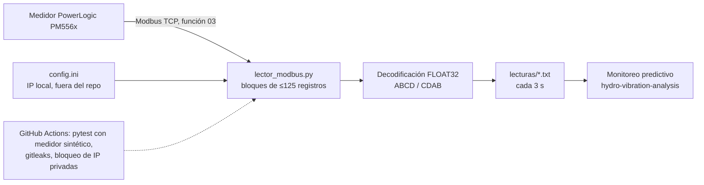

# Lector Modbus

> **Caso de estudio en 1 minuto** · [English](README.md)

**Problema de negocio.** Una planta o una empresa con un medidor eléctrico industrial (PowerLogic PM556x) solo ve los valores en la pantalla del equipo o en un software propietario caro. Sin un registro propio de voltaje, corriente y potencia, no puede detectar sobrecargas, justificar consumos ni alimentar un sistema de mantenimiento predictivo.

**Solución.** Un programa liviano para Windows que lee el medidor por Modbus TCP cada 3 segundos y guarda cada lectura en archivos de texto, listo para analizar. Corre en consola o en segundo plano desde la bandeja del sistema.



**Impacto medido**
- **945 valores del medidor** (FLOAT32, 2 registros cada uno) leídos en cada ciclo, agrupados en bloques de hasta 125 registros, el máximo del protocolo.
- **Una lectura cada 3 segundos** por defecto, unas 28.800 al día, en archivos `.txt` propios.
- **15 pruebas automáticas** con un medidor sintético (bloques, FLOAT32 ABCD/CDAB, bloque caído, reporte, configuración); el CI tarda unos 15 segundos ([workflow](https://github.com/COMPUMAX-EC/lector-modbus/actions/workflows/ci.yml)).
- **Ninguna IP real en el código:** el CI falla si aparece una IP de red privada, y gitleaks revisa todo el historial.

---

Lee por Modbus TCP (función 03) el medidor eléctrico **PowerLogic PM556x** y guarda cada lectura (cada 3 s) en archivos `.txt` dentro de `lecturas/`.

- `lector_modbus.py`: programa principal (consola o bandeja del sistema).
- `registros_pm556x.py`: mapa de registros; `generar_registros.py` lo regenera.
- `generar_manual.py`: genera `Manual-LectorModbus-DevIAlabs.pdf`.
- `*.spec`: builds de PyInstaller (consola y segundo plano).

## Configuración

Copie `config.ini.example` como `config.ini` junto al ejecutable y ponga la IP de su medidor. Si no existe, el programa crea uno con `127.0.0.1` (útil con un simulador). La IP real nunca va en el código.

`config.ini`, `lecturas/`, `build/` y `dist/` se quedan en local.

No confundir con el proyecto de vibraciones (`hydro-vibration-analysis`).

## Pruebas

Las pruebas usan un **medidor sintético** (un cliente Modbus falso con valores inventados), así que no necesitan red ni el equipo real:

```bash
pip install -r requirements-dev.txt
python -m pytest -q tests
```

Cubren la agrupación de registros en bloques (límite de 125 del protocolo), la decodificación FLOAT32 en orden ABCD y CDAB, la lectura con un bloque caído y el reporte `.txt`. Corren en cada PR en GitHub Actions.

## Seguridad y licencia

- GitHub Actions revisa todo el historial con **gitleaks** en cada PR y cada lunes, y falla si aparece una IP de red privada en el código.
- Licencia [MIT](LICENSE).
