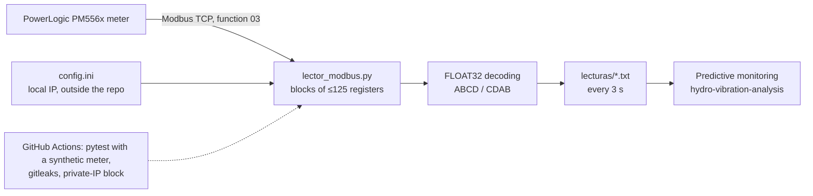

# Modbus Reader

> **1-minute case study** · [Español](README.es.md)

**Business problem.** A plant or company with an industrial power meter (PowerLogic PM556x) can only see the values on the device screen or in expensive proprietary software. Without its own log of voltage, current and power, it cannot catch overloads, justify consumption or feed a predictive-maintenance system.

**Solution.** A lightweight Windows program that reads the meter over Modbus TCP every 3 seconds and saves each reading to text files, ready to analyze. It runs in a console or in the background from the system tray.



**Measured impact**
- **945 meter values** (FLOAT32, 2 registers each) read every cycle, grouped into blocks of up to 125 registers, the protocol maximum.
- **One reading every 3 seconds** by default, about 28,800 a day, in the plant's own `.txt` files.
- **15 automated tests** with a synthetic meter (blocks, FLOAT32 ABCD/CDAB, a dropped block, the report, configuration); CI takes about 15 seconds ([workflow](https://github.com/COMPUMAX-EC/lector-modbus/actions/workflows/ci.yml)).
- **No real IP in the code:** CI fails if a private network IP appears, and gitleaks scans the whole history.

---

## Files

- `lector_modbus.py`: main program (console or system tray).
- `registros_pm556x.py`: register map; `generar_registros.py` regenerates it.
- `generar_manual.py`: builds `Manual-LectorModbus-DevIAlabs.pdf` (Spanish manual).
- `*.spec`: PyInstaller builds (console and background).

## Configuration

Copy `config.ini.example` to `config.ini` next to the executable and set your meter's IP. If it does not exist, the program creates one with `127.0.0.1` (useful with a simulator). The real IP never goes in the code.

`config.ini`, `lecturas/`, `build/` and `dist/` stay local.

Not to be confused with the vibration project ([hydro-vibration-analysis](https://github.com/COMPUMAX-EC/hydro-vibration-analysis)).

## Tests

The tests use a **synthetic meter** (a fake Modbus client with made-up values), so they need neither a network nor the real device:

```bash
pip install -r requirements-dev.txt
python -m pytest -q tests
```

They cover grouping registers into blocks (the protocol's 125 limit), FLOAT32 decoding in ABCD and CDAB order, reading with a dropped block and the `.txt` report. They run on every PR on GitHub Actions.

## Security and license

- GitHub Actions scans the whole history with **gitleaks** on every PR and every Monday, and fails if a private network IP appears in the code.
- [MIT](LICENSE) license.
